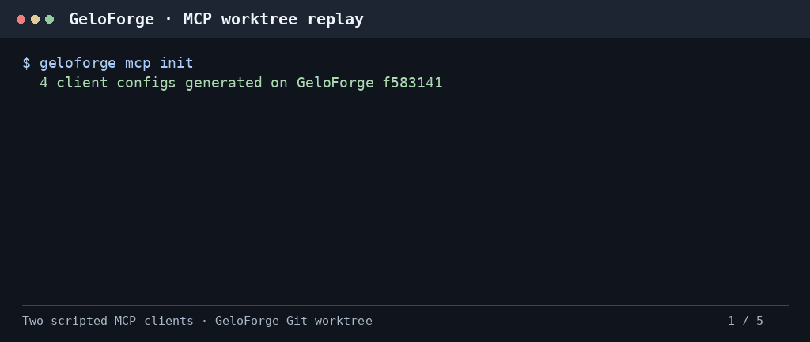

# GeloForge

**Switch AI coding agents without starting over.**

GeloForge is an open-source, local-first harness that keeps project context, task progress, and test results in your Git repo. Start a task in Claude Code, hand it off to Codex, and pick up from the files both agents can read.

[](https://github.com/63L0/GeloForge/actions/workflows/ci.yml)
[](https://www.npmjs.com/package/geloforge)
[](https://nodejs.org/)
[](./LICENSE)

## Quick start

Run this from the root of an existing Git repo with Node.js 20+ and Git installed. The preview shows what GeloForge would add.

```bash
npx geloforge adopt --dry-run
```

When you're ready to set it up:

```bash
npx geloforge adopt
npx geloforge status
```

See the [5-minute walkthrough](./docs/quickstart-5min.md), [paste setup instructions into your agent](./docs/beginner-prompts.md), or [start a new project](./docs/new-projects.md).

## Why GeloForge?

- **Resume faster.** Give the next session a focused packet of project decisions, constraints, and active work.
- **Hand off a task.** Record what's done, what's open, and what the next agent should do.
- **See what ran.** Capture real command results and generate a verification report for your pull request.

## See it in action

Say you've started a bug fix in Claude Code and want to finish it in Codex. Start with a tracked task, then save a handoff when you're ready to switch. Use the task ID GeloForge prints in place of `TASK-0001` if it differs.

```bash
npx geloforge task new --title "Fix checkout validation" --activate
npx geloforge handoff --task TASK-0001 --from-tool claude-code --to-tool codex \
  --next-action "Finish validating checkout inputs and run the regression tests"
```

In Codex, point the agent to the generated handoff and load the task context. When the fix is ready, verify it and generate the PR report. Use your project's test command after `--`.

```bash
npx geloforge context --task TASK-0001
npx geloforge verify --task TASK-0001 -- node --test
npx geloforge report --task TASK-0001
```

<details>
<summary>Watch the 15-second terminal replay of two scripted MCP sessions</summary>



[Case study and reproduction steps](./docs/dogfooding-v06.md)

</details>

## Set up your editor

```bash
npx geloforge mcp init
npx geloforge doctor
```

GeloForge runs as a local CLI or stdio MCP server with zero runtime dependencies. See the [MCP setup guide](#9-zero-dependency-mcp-server-1-command-client-init--sha-256-tool-pinning-mcp) for supported clients and options.

## Table of Contents

- [Copy-paste prompts](#beginner-copy-paste-ai-prompts)
- [Full feature guide](#what-you-can-do)
- [Command reference](#complete-cli-command-reference)
- [Project architecture](#how-it-fits-your-project)
- [Documentation](#documentation)
- [Contributing](#contributing)

---

## Beginner Copy-Paste AI Prompts

Don't want to type CLI flags? Copy and paste any of these prompts directly to your AI coding agent (**[full prompt guide](./docs/beginner-prompts.md)**):

| What you want to do | Copy & paste this prompt to your AI agent |
| --- | --- |
| **Start a new feature or bug fix** | `Let's work on this goal using GeloForge: "<YOUR GOAL>". First run npx geloforge doctor --skip-mcp-check, then create and activate a task with npx geloforge task new --title "..." --activate. Run npx geloforge skills suggest --task <TASK-ID> --goal "<YOUR GOAL>" and compile context with npx geloforge context --task <TASK-ID> --map --skills. Tell me your plan before editing files.` |
| **Prove changes actually pass tests** | `Before marking our task done, run our real test command using npx geloforge verify --task <TASK-ID> -- <TEST_COMMAND> (e.g. node --test). Show me the exact pass/fail output and EVID-* ID. Do not mark the task done if tests fail.` |
| **Chat is getting too long (Fresh Chat)** | `This conversation is getting long. Run npx geloforge compact --summary "<SHORT SUMMARY>", confirm the CHKPT-* ID saved, and give me the exact ready-to-paste fresh-chat prompt so I can continue in a new chat window without losing context.` |
| **Use a built-in starter skill template** | `Run npx geloforge skills suggest to see which starter skill template best fits our repo, then preview staging it with npx geloforge skills suggest --template <TEMPLATE-ID> --scaffold-draft --dry-run and explain what it checks before writing it.` |
| **Check if everything is healthy** | `Run npx geloforge doctor in this project, explain any warnings or failures in plain English, and show me the exact fix commands before running anything.` |
| **Create a PR verification summary** | `Run npx geloforge report and show me the Markdown verification table of our tasks, EVID-* test receipts, latest checkpoint, and doctor health checks so I can paste it into my pull request.` |

---

## What you can do

### 1. Smart Context Compiler & Contextual BM25 (`context`)

Instead of dumping your whole repository into a prompt (wasting tokens and causing the model to forget rules in the middle), `geloforge context` compiles a deterministic, schema-validated `L4` Markdown packet (`CPACK-0001`):

- **Zero-Dependency Contextual BM25:** Indexes both document terms and **Markdown headings (`#`–`####`)** into `headerText`, so authoritative architecture docs (`brain/architecture/overview.md`, `ADR-*`) outrank noisy research notes.
- **3-Zone Edge-Anchored Layout (Anti-"Lost-in-the-Middle"):**
  - **Top Edge (Prefix):** Mandatory `A0` safety/governance policies + `A1`–`A2` requirements, constraints, and accepted ADRs.
  - **Middle Zone:** `A5`–`A6` non-authoritative reference notes, portable skills, codebase symbol map, and selection trace.
  - **Bottom Edge (Recency Anchor):** Unresolved `CONF-NNNN` conflicts (never silently dropped) + `A3`–`A4` active tasks, active multi-IDE peer leases, and verified evidence.
- **Token Budget Profiles & Diff Focus:**
  - `--profile quick` (`~4,000` est. tokens), `--profile working` (`~8,000` est. tokens, default), `--profile deep` (`~16,000` est. tokens), or custom `--budget <tokens>`.
  - `--from-diff` focuses context on your current Git working-tree changes.
  - **Automatic Completed-Task Pruning:** Completed, cancelled, and superseded tasks are automatically omitted to prevent context bloat (pass `--include-completed` when you need historical tasks).
  - `--exclude-unverified` strips all `A5`–`A6` research, draft records, and unverified skills for strict trust isolation.
  - `--cache` reuses an unchanged query packet from `local-runtime/context-cache/` and automatically bypasses the disk cache while active task leases exist.
  - Escapes spoofed prompt-delimiter markers (`<<<ESCAPED_GELOFORGE_DOC`) inside untrusted documents.

```bash
npx geloforge context --task TASK-0001 --map --skills --profile working
npx geloforge context --from-diff --map --profile quick
npx geloforge context --query "payment retry logic" --exclude-unverified --out ./context-packet.md
```

### 2. 15+ Language Codebase Symbol Mapper (`context --map`)

Add `--map` (and optional `--map-budget <tokens>`) to extract a compact structural outline of your most relevant source files with exact `L<line>` numbers — without dumping raw file bodies:

- **15+ Supported Languages:** JavaScript, TypeScript, Python, Go, Rust, Java, C#, Kotlin, C/C++, Shell, SQL, Markdown, JSON, YAML, and TOML (with graceful summary fallback for unsupported file extensions).
- **1-Hop Import Graph Centrality Boost:** Automatically boosts files imported by your task's `required_inputs` and omits files already included verbatim.
- **Scales to Large Repositories:** Bounded pre-ranked path scanning handles `1,200+` file repositories quickly.
- **Hard Secret & Artifact Exclusions:** Respects `.gitignore` (`git ls-files` + fallback walk) and hard-blocks `.env*`, `secrets/`, private keys, credentials, binaries, lockfiles, `node_modules/`, `dist/`, `obj/`, and `bin/`.

### 3. 1-Command Long-Session Compaction & Checkpoints (`compact` / `checkpoint`)

When an AI chat thread gets long, models lose focus and token costs spike. GeloForge solves long-session fatigue at both the detector and action level:

- **`npx geloforge compact` (or `geloforge checkpoint compact`):**
  1. Saves a schema-valid `CHKPT-NNNN` recovery checkpoint recording your current Git branch, commit SHA, working-tree cleanliness, active tasks, `state_revision`, and latest verified `EVID-*`.
  2. Compiles a slim, diff-focused `quick` context packet with completed tasks pruned (optionally saved via `--out <file>`).
  3. Prints a **ready-to-paste Fresh Chat Prompt** so you can open a brand-new chat window and resume in 5 seconds.
- **Automatic Long-Session Detection (`session_hygiene`):** `geloforge doctor` and `geloforge recommend` automatically warn when `active_tasks > 3`, when `>= 10` dirty files accumulate without a checkpoint, or when `state_revision >= 8` has no checkpoint.
- **Full Checkpoint Commands:** `checkpoint create`, `checkpoint list`, `checkpoint show`, `checkpoint resume`, `checkpoint compact`, plus `--local` checkpoints under `local-runtime/checkpoints/`.

```bash
npx geloforge compact --summary "Auth middleware verified; ready for billing endpoints"
npx geloforge checkpoint resume
npx geloforge checkpoint list
```

### 4. Real Command Evidence & Fail-Closed Verification (`verify` / `evidence`)

Stop taking an AI agent's word for `"all tests pass"`:

- **Direct Process Execution (`shell: false`):** `evidence capture` and `verify` execute commands directly without a shell interpreter — preventing shell metacharacter injection.
- **Fail-Closed Verification Status:**
  - Exit code `0` → writes `evidence/EVID-NNNN-*.yaml` with `status: "verified"` and updates `last_verified_evidence`.
  - Non-zero exit code or `--timeout <ms>` → writes `status: "draft"` (never `verified`), exits non-zero, and keeps the task open for fixes.
- A fresh passing check can complete the task after a failed capture. Earlier draft receipts remain in the task history.
- **Automatic Secret Redaction:** Redacts API keys, bearer tokens, private keys, and credentials from captured stdout/stderr before writing to disk.
- **1-Command Task Closure (`geloforge verify`):** Runs your test command, records `EVID-NNNN`, saves a `CHKPT-NNNN` checkpoint, and marks the active task completed with `--require-evidence`.

```bash
# Capture intermediate proof (leaves task open)
npx geloforge evidence capture --task TASK-0001 --name "Unit suite" -- node --test

# Run check + save verified evidence + save checkpoint + complete task
npx geloforge verify --task TASK-0001 -- node --test
```

Use your project's test runner. On Windows, launch the runner through its executable or pass its JavaScript entry point to `node`. The `npm.cmd` shim requires a shell.

### 5. Shareable PR & Project Verification Reports (`report`)

Generate a clean **GitHub-Flavored Markdown** (or `--json`) verification summary across your project or a single task (`--task TASK-NNNN`) — ready to paste into a GitHub Pull Request description or release audit:

- **Summary Metrics Table:** Project validation status, compatibility, Git branch/commit/dirty count, Doctor health counts (`pass`/`warn`/`fail`), active tasks, latest `EVID-*`, and latest `CHKPT-*`.
- **Task Status Table:** Task ID, Title, Status, Verification (`verified` vs `unverified`), and linked Evidence IDs.
- **Verified & Draft Evidence Receipts Table:** Evidence ID, Status, Task, exact Command(s) run, and Exit Code(s).
- **Session Checkpoint & Doctor Health Tables:** Latest resume instructions + all 9 `doctor` check results.

```bash
npx geloforge report
npx geloforge report --task TASK-0001 --out ./pr-verification-report.md
npx geloforge report --check-mcp --json
```

### 6. Cross-Agent File Handoffs (`handoff`)

Switch smoothly from one AI assistant or role to another (e.g., **Codex CLI → Gemini CLI** or **Cursor Developer → Claude Code QA Reviewer**):

- Writes schema-valid `handoffs/HANDOFF-NNNN-*.yaml` records with `--from-role`, `--to-role`, `--from-tool`, `--to-tool`, `--completed`, `--open`, `--claim`, `--blocker`, `--question`, `--risk`, and `--next-action`.
- **Audited Proof Separation (`handoff --inspect`):** Automatically cross-checks every referenced `EVID-*` file on disk. Only real `status: "verified"` records with passing checks enter `verified_evidence`; unbacked test/build claims passed in `--completed` or `--claim` are quarantined into `unverified_claims` and trigger explicit `contradiction_warnings`. Also detects Git `HEAD` drift since the handoff was written.

```bash
npx geloforge handoff \
  --task TASK-0001 \
  --from-role developer --to-role qa-security-reviewer \
  --from-tool cursor --to-tool claude-code \
  --completed "Implemented webhook signature check" \
  --next-action "Run security review and verify EVID-0001"

npx geloforge handoff --inspect handoffs/HANDOFF-0001-task-0001.yaml
```

### 7. Scoped Tasks, Multi-IDE File Leases & Git Worktrees (`task` / `worktree`)

Run multiple AI sessions in parallel without stepping on each other's toes:

- **Scoped Task Contracts (`TASK-NNNN`):** Define `--title`, `--objective`, `--priority` (`low`|`medium`|`high`|`critical`), `--role`, `--budget` (`quick`|`working`|`deep`), `--criteria`, `--scope-in`, `--scope-out`, `--input`, and `--dep`.
- **Cooperative Multi-IDE File-Scope Leases (`.geloforge/task-leases.yaml`):**
  - Claim ownership of a task and file/folder prefix with a bounded TTL (`1`–`1440` minutes, default `120`):
  - Any overlapping `task claim` from another tool/session is blocked (unless `--force`), and active peer leases are automatically highlighted inside every `geloforge context` packet and `geloforge status` / `recommend`.
- **Clean-Checked Git Worktrees (`worktree`):** Create, list, and remove isolated Git worktrees under `<workspace>/worktrees/<name>` on dedicated branches (`worktree remove` delegates to Git's clean-worktree check and preserves the branch).

```bash
npx geloforge task claim --task TASK-0001 --tool cursor --session sess-1 --scope src/webhooks --ttl 120
npx geloforge task leases
npx geloforge task release --task TASK-0001 --tool cursor --session sess-1
npx geloforge task done --task TASK-0001 --require-evidence --evidence EVID-0001

npx geloforge worktree add feature-audit
npx geloforge worktree list
```

### 8. Portable Agent Skills, Advisor, 5 Starter Templates & Ed25519 Lifecycle (`skills`)

GeloForge supports portable [agentskills.io](https://agentskills.io)-compatible `SKILL.md` packages in `.agents/skills/` (project) and `~/.geloforge/skills/` (`GELOFORGE_SKILLS_DIR` global) with strict quarantine and cryptographic promotion:

- **3-Tier Progressive Token Disclosure (`context --skills`):**
  - **Tier 0 (Compact Index):** Lightweight skill summaries so agents know what skills exist without blowing the token budget.
  - **Tier 1 (Active Instructions):** Full `SKILL.md` instructions loaded only for the highest-ranked or explicitly pinned (`--skill <name>`) skills within `--skills-budget`.
  - **Tier 2 (Lazy Supporting Resources):** Relative pointers to `scripts/`, `references/`, and `assets/` (never auto-executed).
- **Deterministic Project/Goal Skills Advisor (`skills suggest`):**
  - Scans your repo (`package.json`, `pyproject.toml`, `go.mod`, `Cargo.toml`, `Dockerfile`, `.github/workflows`, `n8n`, `brain/requirements/constraints.md`, `brain/architecture/overview.md`, active tasks, and `EVID-*` history).
  - Ranks existing skills using Contextual BM25, detects coverage gaps (`evidence_backed_workflow`, `goal_workflow`, `repo_baseline_workflow`), and can stage a quarantined draft under `proposals/skills/<name>/SKILL.md` (`--scaffold-draft`).
- **5 Built-In Curated Starter Skill Templates (`--template <id>`):**

| Starter Template ID | Target Stacks & Domains | What the Quarantined Skill Draft Checks |
| --- | --- | --- |
| `web-ui-verification` | `web`, `react`, `nextjs`, `vue`, `nuxt`, `tailwind`, `playwright`, `cypress`, `typescript` | Component state transitions, empty/error states, form/boundary validation, and typecheck/build/E2E verification |
| `backend-api-contracts` | `node`, `express`, `fastify`, `python`, `go`, `rust`, `prisma`, `drizzle`, `postgres`, `stripe` | Request/response schema validation, auth boundaries, transactional rollback/idempotency, and migration tests |
| `automation-workflow-guardrails` | `automation`, `n8n`, `ci`, `github-actions`, `docker` | Trigger filters, dry-run paths, secret redaction, timeout bounds, retry idempotency, and staged execution checks |
| `desktop-mobile-release-check` | `desktop`, `mobile`, `ai-system` | Cross-platform Windows/POSIX path safety, atomic temp-file writes, offline persistence, and clean-room bundle smoke tests |
| `security-and-regression-gate` | `node`, `python`, `go`, `rust`, `ci` (universal security/bugfix gate) | Failing regression test reproduction, path-confinement/secret-redaction audits, and fail-closed `geloforge verify` proof |

- **Static Security & Quality Linter (`skills lint [--strict]`):** Checks every `SKILL.md` and supporting file for prompt-injection overrides, remote shell pipes (`curl | sh`), credential literals, symlink escapes, and broken relative links.
- **Evidence-Backed Adaptive Skill Lifecycle & Ed25519 Promotion:**
  - Unverified repo/template scaffolds in `proposals/skills/` intentionally lack `.proposals/<name>.yaml` provenance and **cannot be promoted** until real `EVID-*` verification is captured and drafted via `skills draft --from-evidence EVID-NNNN`.
  - Promotion (`skills promote`) and rollback (`skills rollback`) require genuine human authorization: **Ed25519 cryptographic signature** (`--approval APPR-NNNN --public-key <pinned.pem>`), **isolated PR review branch** (`--mode pr-branch`), or **local interactive TTY confirmation** (`--interactive`). Self-reported flags like `--approved-by` are strictly refused.
  - Append-only SHA-256 revision ledger and verified snapshot rollback (`skills history`, `skills rollback`).

```bash
# Suggest skills + stage a curated starter template into quarantine (proposals/skills/)
npx geloforge skills suggest --goal "Validate API webhook contracts"
npx geloforge skills suggest --template backend-api-contracts --scaffold-draft

# Draft an evidence-backed skill, lint it, sign with Ed25519, and promote to .agents/skills/
npx geloforge skills draft --from-evidence EVID-0001 --name webhook-contract-check
npx geloforge skills lint --include-drafts --strict
npx geloforge skills keygen --approver-id owner-main --out ./keys/owner-main.private.pem --pub-out ./keys/owner-main.pub.pem
npx geloforge skills sign --skill webhook-contract-check --key ./keys/owner-main.private.pem --approver owner-main
npx geloforge skills promote webhook-contract-check --approval APPR-0001 --public-key ./keys/owner-main.pub.pem
```

### 9. Zero-Dependency MCP Server, 1-Command Client Init & SHA-256 Tool Pinning (`mcp`)

GeloForge includes a built-in, zero-dependency **Model Context Protocol (MCP)** stdio server (`JSON-RPC 2.0` over newline-delimited JSON or `Content-Length` LSP framing, bounded to `1 MB` messages / `4 KB` headers) pinned to your project root:

- **1-Command Client Configuration (`npx geloforge mcp init`):** Preserves your existing settings/comments and configures both the MCP server entry and project rule file across **5 major AI coding clients**:

| Client (`--client <name>`) | MCP Configuration File | Project Rules / Instructions File |
| --- | --- | --- |
| `cursor` *(default)* | `.cursor/mcp.json` | `.cursor/rules/geloforge.mdc` |
| `vscode` *(default)* | `.vscode/mcp.json` | `.github/instructions/geloforge.instructions.md` |
| `claude` *(default)* | `.mcp.json` | `.claude/rules/geloforge.md` |
| `gemini` *(default)* | `.gemini/settings.json` | `GEMINI.md` |
| `antigravity` *(`--client antigravity`)* | `.agents/mcp_config.json` | `AGENTS.md` |

- **6 Project-Confined MCP Tools (with `--read-only` mode, `input_examples`, and self-correcting error hints):**

| MCP Tool Name | Read-Only Actions (Always Allowed) | State-Mutating Actions (Blocked in `--read-only`) | Strictly Refused Over MCP (Human CLI Only) |
| --- | --- | --- | --- |
| `geloforge_status` | `status` (validation, state, leases, inbox) | *(none)* | *(none)* |
| `geloforge_recommend` | `recommend` (ranked Co-Pilot next actions) | *(none)* | *(none)* |
| `geloforge_context` | `context` (BM25 3-zone packet, `--map`, `--skills`, `--from-diff`) | *(none)* | *(none)* |
| `geloforge_task` | `list`, `show`, `leases` | `new`, `update`, `done`, `claim`, `release` | *(none)* |
| `geloforge_checkpoint` | `list`, `show`, `resume` | `create`, `compact` | *(none)* |
| `geloforge_skills` | `list`, `show`, `validate`, `lint`, `suggest`, `history` | `draft`, `propose`, `scaffold` *(quarantine `proposals/skills/` only!)* | `promote`, `rollback`, `keygen`, `sign` |

- **Cryptographic MCP Tool-Surface Pinning (`npx geloforge mcp lock`):**
  - Spawns each configured stdio MCP server locally (zero network calls), queries `tools/list`, normalizes tool names/descriptions/schemas into canonical JSON, and writes SHA-256 digests to `.geloforge/mcp-lock.json`.
  - Run `npx geloforge mcp lock --check` (or automatically via `geloforge doctor` and the Git `pre-commit` hook) to catch added, removed, or silently mutated MCP tools before an agent uses them.

```bash
npx geloforge mcp init
npx geloforge mcp init --client antigravity
npx geloforge mcp lock
npx geloforge mcp lock --check
```

### 10. Bounded Coding Loops (`loop`), Autonomous Staging Audits (`autonomous`) & Canonical Proposals (`proposal`)

For advanced automation and multi-agent verification, GeloForge provides three human-governed execution engines:

- **Bounded Coding Loop (`geloforge loop run` / `loop status`):**
  - Orchestrates a capped `implement → verify → review → fix` loop for an open task using a local JSON config.
  - Compiles upfront symbol-mapped context (`includeMap: true`, and `fromDiff: true` on fix rounds), runs deterministic verification commands (`shell: false`), and enforces **fail-closed reviewer `policy_checks`** (an LLM reviewer approval is rejected if any policy check fails or if the real test command fails).
- **Opt-In Autonomous Staging Audits (`geloforge autonomous`):**
  - Defaults to **`OFF`** per project (`autonomous status|on|off`).
  - Supports **Ed25519-signed worker configs** (`autonomous authorize` binding workflow allowlists, provider executable SHA-256 bytes, timeout bounds, and launch caps) for **Codex CLI (`codex`), Gemini CLI (`gemini`), and Antigravity (`antigravity`)** — either single-specialist or parallel 2-specialist + independent reviewer profiles.
  - Ships a ready-to-import **[n8n Staging Error Delivery Workflow](./adapters/n8n/staging-audit-error-workflow.json)** (`autonomous watch [--once]`) plus offline failure verification (`autonomous audit --event failure.json --execution execution.json`) and resumable progress (`autonomous progress`).
  - **Recurring-Failure Skill Learning (`autonomous learn`):** Detects recurring failed-node patterns across `>= 2` verified staging executions and drafts a quarantined skill or update proposal for owner review.
- **Signed Canonical Document Promotion (`geloforge proposal preview|sign|promote`):**
  - Protects `brain/requirements/*` and `brain/decisions/ADR-*.md` so canonical specifications can only be promoted when bound to verified `EVID-NNNN` records and an Ed25519 owner signature (`APPR-NNNN`).

```bash
# Bounded implement -> verify -> review -> fix coding loop
npx geloforge loop run --config local-runtime/loop.json --task TASK-0001 --dry-run
npx geloforge loop status --task TASK-0001

# Canonical ADR / requirements proposal signing & promotion
npx geloforge proposal preview --proposal proposals/constraints.md --target brain/requirements/constraints.md --evidence EVID-0001
npx geloforge proposal sign --proposal proposals/constraints.md --target brain/requirements/constraints.md --evidence EVID-0001 --key ./keys/owner.private.pem
npx geloforge proposal promote --proposal proposals/constraints.md --target brain/requirements/constraints.md --evidence EVID-0001 --approval APPR-0001 --owner-key ./keys/owner.pub.pem
```

### 11. One-Command Diagnostics (`doctor`), Ambient Hooks (`hooks init`) & Co-Pilot (`recommend`)

- **`npx geloforge doctor` (9 Deterministic Health Checks):**
  1. `node_runtime` — verifies Node.js `>= 20.0.0`.
  2. `project_validation` — validates all 12 JSON Schemas, record IDs, cross-references, and Markdown links.
  3. `harness_compatibility` — checks `brain/manifest.yaml` `harness_version` and schema compatibility (`1.0` & `1.1`).
  4. `git_repository` — inspects Git branch and uncommitted working-tree changes.
  5. `task_leases` — checks active and expired multi-IDE file-scope leases.
  6. `skills_health` — runs static security & quality lint across active and quarantined skills.
  7. `mcp_lock` — verifies `.geloforge/mcp-lock.json` integrity and probes live stdio MCP servers for schema drift.
  8. `hooks_configured` — checks installed ambient Git / Claude Code / Gemini CLI hooks and symlink safety.
  9. `session_hygiene` — detects long or uncompacted sessions and recommends `geloforge compact`.
- **`npx geloforge hooks init` (Opt-In Ambient Guardrails, Zero Background Daemons):**
  - `git`: Adds a managed block to `.git/hooks/pre-commit` that runs `geloforge validate` (and `geloforge mcp lock --check` when `.geloforge/mcp-lock.json` exists) before commits.
  - `claude`: Adds an advisory `hooks.Stop` check in `.claude/settings.json` while preserving existing settings.
  - `gemini`: Adds an advisory `hooks.AfterAgent` check in `.gemini/settings.json` while preserving existing `mcpServers`.
- **`npx geloforge recommend` (Human-in-the-Loop Co-Pilot & Approval Inbox):**
  - Scans pending skill proposals, `APPR-*` records, proposed `ADR-*` decisions, open `CONF-*` conflicts, blocked staging audits, overlapping multi-IDE leases, and session hygiene — ranking your next best actions with explicit trade-offs.

---

## Complete CLI Command Reference

Run `npx geloforge --help` or `npx geloforge <command> --help` anytime. Every command supports `--project <path>` (auto-detected from your current working directory or any nested subfolder) and `--json` for machine-readable output:

| Command | Subcommands / Key Flags | What It Does |
| --- | --- | --- |
| `init` | `--name "<Name>" [--profile web\|desktop\|mobile\|automation\|ai-system] [--dest <dir>] [--git] [--dry-run]` | Scaffold a brand-new project with a Second Brain and optional domain profile |
| `adopt` | `[--dest <dir>] [--profile <name>] [--with-agent-guides] [--dry-run]` | Add GeloForge Second Brain to an existing repository without touching app files |
| `status` | `[--project <dir>] [--json]` | Inspect validation health, operational state, active tasks, leases, inbox, and Git state |
| `doctor` | `[--include-drafts] [--skip-mcp-check] [--timeout-ms <ms>] [--json]` | Run all 9 health checks (`pass`/`warn`/`fail`) with exact fix commands |
| `recommend` | `[--project <dir>] [--json]` | Show ranked Human-in-the-Loop Co-Pilot next actions and pending approvals inbox |
| `task` | `new \| update \| done \| claim \| release \| leases \| list \| show` | Manage `TASK-NNNN` contracts, `--require-evidence` completion, and multi-IDE file leases |
| `context` | `(--task TASK-NNNN \| --query <text> \| --from-diff) [--profile quick\|working\|deep] [--map] [--skills] [--cache] [--exclude-unverified] [--out <file>]` | Compile a deterministic, 3-zone Contextual BM25 prompt packet and `CPACK-0001` manifest |
| `evidence` | `capture --task TASK-NNNN [--name <text>] [--timeout <ms>] [--dry-run] -- <cmd> [args...]` | Execute an explicit command (`shell: false`), redact secrets, and write `EVID-NNNN` |
| `verify` | `[--task TASK-NNNN] [--name <text>] [--timeout <ms>] [--dry-run] -- <cmd> [args...]` | Run a check, record verified `EVID-NNNN`, save `CHKPT-NNNN`, and complete the task |
| `compact` | `[--task TASK-NNNN] [--summary <text>] [--profile quick] [--no-map] [--skills] [--out <file>] [--local] [--dry-run]` | 1-command long-session compaction: saves `CHKPT-NNNN`, builds slim resume packet, prints Fresh Chat Prompt |
| `report` | `[--task TASK-NNNN] [--check-mcp] [--out <file>] [--dry-run] [--json]` | Generate shareable Markdown/JSON PR & project verification tables |
| `checkpoint` | `create \| list \| show \| resume \| compact` | Create, list, inspect, compare/resume, or compact `CHKPT-NNNN` session recovery checkpoints |
| `handoff` | `[--task TASK-NNNN] [--from-role <r>] [--to-role <r>] [--from-tool <t>] [--to-tool <t>] \| --inspect <file.yaml>` | Create or audit cross-agent `HANDOFF-NNNN` transfers (`verified_evidence` vs `unverified_claims`) |
| `skills` | `list \| show \| validate \| lint \| suggest \| draft \| propose-update \| keygen \| sign \| promote \| history \| rollback` | Discover, recommend (`--template <id> --scaffold-draft`), security-lint, Ed25519-sign, promote, or roll back `SKILL.md` skills |
| `mcp` | `[serve] [--read-only] \| init [--client cursor\|vscode\|claude\|gemini\|antigravity] \| lock [--check]` | Run the zero-dependency stdio MCP server, configure IDE clients, or pin/check SHA-256 tool schemas |
| `hooks` | `init [--target git,claude,gemini] [--dry-run] [--json]` | Preview or install opt-in Git `pre-commit`, Claude Code `hooks.Stop`, and Gemini CLI `hooks.AfterAgent` hooks |
| `loop` | `run --config <file.json> [--task TASK-NNNN] [--dry-run] \| status [--task TASK-NNNN]` | Run or inspect a bounded `implement → verify → review → fix` coding loop |
| `autonomous` | `status \| on \| off \| audit \| authorize \| watch [--once] \| progress \| learn` | Run Ed25519-authorized staging failure audits (n8n + Codex/Gemini/Antigravity) and learn recurring failure skills |
| `proposal` | `preview \| sign \| promote (--proposal <file> --target <file> --evidence EVID-NNNN)` | Preview, Ed25519-sign, and promote canonical `brain/requirements/*` and `ADR-*` proposals |
| `worktree` | `list \| add <name> [--ref <ref>] \| remove <name>` | Manage isolated, clean-checked Git worktrees under `<workspace>/worktrees/` |
| `validate` | `[--project <dir>] [--json]` | Validate all 12 JSON Schemas, `1.0`/`1.1` compatibility, IDs, references, symlinks, and Markdown links |

---

## How it fits your project

Everything GeloForge adds lives in clean, human-readable folders — never modifying your application source code:

| Folder / File | What Lives Here |
| --- | --- |
| `brain/` | **Authoritative Second Brain:** `manifest.yaml`, `INDEX.md`, `requirements/prd.md`, `requirements/constraints.md`, `architecture/overview.md`, `decisions/ADR-*.md`, `conflicts/CONF-*.yaml`, `incidents/INC-*.yaml`, `research/RES-*.md`, and `state/current.yaml` |
| `tasks/` | Scoped `TASK-NNNN` YAML contracts with objectives, file scopes (`scope_in` / `scope_out`), and acceptance criteria |
| `evidence/` | Tamper-evident `EVID-NNNN` YAML manifests of real commands run (`shell: false`), exit codes, and secret-redacted outputs |
| `handoffs/` | Session recovery checkpoints (`CHKPT-NNNN`) and cross-agent `HANDOFF-NNNN` transfer records |
| `.agents/skills/` | Trusted, human-approved `SKILL.md` packages unlocked on demand (`Tier 0/1/2`) |
| `proposals/` | Quarantined skill drafts (`proposals/skills/`), canonical document proposals, and `APPR-NNNN` approval records |
| `.geloforge/` | Local coordination & security state: cooperative multi-IDE leases (`task-leases.yaml`), pinned MCP tool hashes (`mcp-lock.json`), cross-process lock (`.state.lock`), and crash-recovery transaction journal (`.tx-journal.json`) |
| `AGENTS.md` / `GEMINI.md` | Auto-maintained agent entrypoint guides so AI tools immediately follow your Second Brain workflow |

### Second Brain Trust Model: 4 Memory Layers, 7 Authority Tiers & 5 Agent Roles

- **4 Memory Layers:**
  - `L1_AUTHORITATIVE` — Canonical PRD, constraints, and accepted `ADR-NNNN` architecture decisions.
  - `L2_OPERATIONAL` — Active `state/current.yaml`, `TASK-NNNN` contracts, `CHKPT-NNNN` checkpoints, `HANDOFF-NNNN` transfers, and `CONF-NNNN` conflicts.
  - `L3_RESEARCH_EVIDENCE` — Verified `EVID-NNNN` command receipts, `INC-NNNN` incidents, and `RES-NNNN` research notes.
  - `L4_TEMPORARY_CONTEXT` — Ephemeral compiled `CPACK-NNNN` context packets.
- **7 Authority Levels (`A0` Highest → `A6` Lowest):**
  - `A0` Mandatory safety, approval, memory, and token-efficiency policies (never truncated) → `A1` Owner constraints/PRD → `A2` Accepted ADRs & signed approvals (`APPR-*`) → `A3` Verified command evidence (`EVID-*`) → `A4` Operational state, tasks, checkpoints & handoffs → `A5` Research notes (`RES-*`) → `A6` Unverified claims & quarantined drafts.
- **12 Strict JSON Schemas (`Draft 2020-12`, `additionalProperties: false`):** Every record is validated against [12 built-in schemas](./schemas/README.md) (`project-manifest`, `project-state`, `task-contract`, `evidence-manifest`, `recovery-checkpoint`, `agent-handoff`, `adr`, `research-record`, `conflict-record`, `approval-record`, `incident-record`, `context-pack-manifest`).
- **5 Built-In Specialized Agent Roles:** `orchestrator`, `researcher`, `software-architect`, `developer`, and `qa-security-reviewer` — each with explicit required inputs, allowed operations, forbidden operations, and handoff contracts.
- **Crash-Safe Reliability & Offline Verification Suite:**
  - Cross-process lock (`.geloforge/.state.lock`) with dead-PID stale-lock reclamation, Windows transient `EPERM`/`EACCES`/`EBUSY` retry hardening, and a **replayable pre-image transaction journal (`.geloforge/.tx-journal.json`)** that automatically rolls back interrupted writes.
  - Verified in CI across **Linux, macOS, and Windows (Node.js 20 & 22)** with `118` automated tests (`npm test`), **`10/10` offline regression evaluations (`npm run eval`)**, synthetic 1,200-file repository benchmarks (`npm run benchmark`), and clean-room tarball smoke tests (`npm run smoke:package`).

---

## Documentation

- [Beginner AI prompts](./docs/beginner-prompts.md) — ready-to-paste prompts so any AI coding agent can set up and run GeloForge for you
- [5-minute quickstart](./docs/quickstart-5min.md) — fastest hands-on CLI walkthrough for beginners
- [CLI and MCP guide](./docs/advanced-usage.md) — in-depth command flags, `mcp lock`, `loop run`, `compact`, `report`, worktrees, and staging audits
- [Portable Agent Skills](./docs/portable-skills.md) — progressive disclosure, static security lint, starter templates, and Ed25519 promotion
- [Creating a new project](./docs/new-projects.md) — greenfield starter templates and [5 domain profiles](./templates/profiles/README.md) (`web`, `desktop`, `mobile`, `automation`, `ai-system`)
- [JSON Schemas reference](./schemas/README.md) & [Multi-session dogfooding case study](./docs/dogfooding-v06.md)
- [Known limitations](./docs/known-limitations.md) & [Security policy](./SECURITY.md) — threat model, trust boundaries, and zero-network guarantees
- [Changelog](./CHANGELOG.md) & [GitHub releases](https://github.com/63L0/GeloForge/releases)

## Contributing

Issues, bug reports, and pull requests are welcome! Share your OS, Node.js version, and command output via [GitHub Issues](https://github.com/63L0/GeloForge/issues). For local tests, benchmarks, and PR checks, read [CONTRIBUTING.md](./CONTRIBUTING.md).
